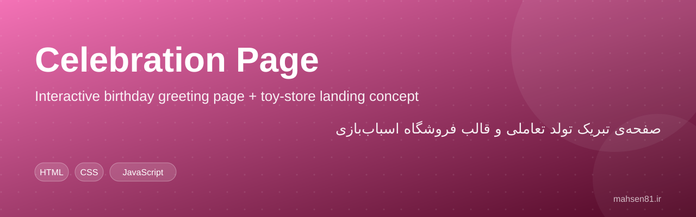

<!-- gen:header -->
<p align="center"></p>

<h1 align="center">Celebration Page</h1>
<p align="center"><b>صفحه‌ی تبریک تولد تعاملی و قالب فروشگاه اسباب‌بازی</b><br><i>Interactive birthday greeting page + toy-store landing concept</i></p>
<p align="center">  </p>

<div dir="rtl">

## ✨ امکانات

- صفحه‌ی تک‌فایلی و سبک
- انیمیشن و تعامل

</div>

## 🚀 Quick start

```bash
Open tabrik-tavalod-mahsa/tavalod-mahsa.html in a browser.
```

---

<!-- gen:docs -->
## 📚 مستندات کامل · Full documentation

# فروشگاه اینترنتی اسباب‌بازی «لی‌لی‌پوپ»

یک وب‌سایت تک‌صفحه‌ای (Single Page) کاملاً استاتیک، ساخته‌شده با **React + TypeScript + Vite**، بدون هیچ نیاز به بک‌اند، دیتابیس یا سرور Node.js. خروجی نهایی فقط شامل فایل‌های HTML، CSS، JS و تصاویر است و مستقیماً روی هاستینگ اشتراکی (cPanel) قابل آپلود است.

## ✨ امکانات پیاده‌سازی‌شده

- نوار پروموشن بالای سایت + هدر واکنش‌گرا با منوی موبایل و کشوی (Drawer) پیش‌نمایش سبد خرید
- بخش Hero با CTA های رنگارنگ
- بخش تعاملی «تجربه باز کردن جعبه» با اسکرول‌اسکراب فریم‌به‌فریم روی `<canvas>` (اسکرول‌کنترل، نه ویدیوی معمولی)
- ویترین دسته‌بندی‌ها (گروه سنی، آموزشی، بازی رومیزی، عروسک و اکشن‌فیگور، کنترلی و فناوری)
- گرید محصولات پرفروش با برچسب، امتیاز، قیمت، افزودن به سبد (شبیه‌سازی‌شده) و نمای سریع (Quick View)
- فیلتر تعاملی بر اساس سن (+۱ سال / ۳ تا ۵ سال / ۶ تا ۹ سال / +۱۰ سال)
- بخش نشان‌های ایمنی، کیفیت و ارزش آموزشی
- نظرات مشتریان و والدین
- فرم مشاوره خرید با اعتبارسنجی سمت کلاینت و پیام‌های خطای فارسی
- فوتر با نشان‌های اعتماد، جای نماد اعتماد الکترونیکی (اینماد) و فرم عضویت خبرنامه

تمام محتوای سایت (محصولات، دسته‌بندی‌ها، نظرات، اطلاعات تماس و ...) در یک فایل قابل‌ویرایش قرار دارد:

```
src/data/toyStoreData.ts
```

برای ویرایش محتوا فقط همین فایل را باز کنید؛ نیازی به تغییر کامپوننت‌ها نیست.

---

## 📁 ساختار پروژه

```
toy-store/
├── public/
│   ├── frames/            ← فریم‌های ویدیوی اسکرول (toy_frame_0001.webp … 0120.webp)
│   ├── products/          ← تصاویر محصولات (SVG جایگزین؛ قابل تعویض با عکس واقعی)
│   └── favicon.svg
├── src/
│   ├── components/        ← تمام کامپوننت‌های React
│   ├── context/           ← Context سبد خرید
│   ├── data/
│   │   ├── toyStoreData.ts    ← داده‌های اصلی سایت (ویرایش محتوا اینجا)
│   │   └── framesManifest.ts  ← تنظیمات دنباله فریم‌های اسکرول‌ویدیو
│   ├── hooks/
│   ├── styles/             ← global.css و sections.css
│   ├── utils/
│   ├── App.tsx
│   └── main.tsx
├── index.html
├── vite.config.ts          ← base: './' برای سازگاری با cPanel
├── package.json
└── README.md
```

---

## 🚀 راه‌اندازی و ساخت پروژه (Build)

### پیش‌نیازها

- [Node.js](https://nodejs.org) نسخه ۱۸ یا بالاتر
- npm (همراه Node نصب می‌شود)

### مراحل

```bash
# ۱. نصب وابستگی‌ها
npm install

# ۲. اجرای نسخه توسعه (پیش‌نمایش محلی با قابلیت رفرش زنده)
npm run dev

# ۳. ساخت نسخه نهایی برای انتشار
npm run build
```

پس از اجرای `npm run build`، یک پوشه به نام **`dist/`** ساخته می‌شود. **تمام محتوای داخل این پوشه** (نه خودِ پوشه) همان چیزی است که باید روی هاست آپلود شود.

می‌توانید خروجی نهایی را پیش از آپلود، به‌صورت محلی تست کنید:

```bash
npm run preview
```

---

## 🎬 فریم‌های اسکرول‌ویدیو (بخش «تجربه باز کردن جعبه»)

این بخش به‌جای پخش ویدیوی معمولی، از یک دنباله تصویر (Frame Sequence) روی `<canvas>` استفاده می‌کند که با اسکرول کاربر، فریم مناسب رسم می‌شود. این روش باعث می‌شود:

- بدون نیاز به بافر شدن ویدیو، بلافاصله قابل نمایش باشد
- روی موبایل و کانکشن ضعیف هم عملکرد روان داشته باشد
- دقیقاً منطبق با موقعیت اسکرول کاربر پیش برود (نه پخش خودکار)

### تولید فریم‌ها از یک ویدیوی منبع

اگر می‌خواهید ویدیوی خودتان را جایگزین کنید، ابتدا `ffmpeg` را نصب کنید و سپس دستور زیر را اجرا کنید:

```bash
ffmpeg -i toy-video.mp4 -vf "fps=24,scale=1280:-1:flags=lanczos" \
  -c:v libwebp -q:v 72 -compression_level 5 \
  public/frames/toy_frame_%04d.webp
```

توضیح پارامترها:

| پارامتر | توضیح |
|---|---|
| `fps=24` | تعداد فریم استخراجی در ثانیه (متناسب با طول ویدیوی منبع؛ برای ویدیوی ۵ ثانیه‌ای حدود ۱۲۰ فریم تولید می‌کند) |
| `scale=1280:-1` | عرض خروجی ۱۲۸۰ پیکسل با حفظ نسبت تصویر |
| `-c:v libwebp` | خروجی با فرمت WebP (حجم پایین + کیفیت خوب) |
| `-q:v 72` | کیفیت فشرده‌سازی (بین ۰ تا ۱۰۰) |

فریم‌های تولیدشده در پروژه فعلی از روی ویدیوی نمونه شما استخراج شده و در مسیر `public/frames/` با نام‌های `toy_frame_0001.webp` تا `toy_frame_0120.webp` قرار دارند (۱۲۰ فریم).

### تغییر تعداد یا مسیر فریم‌ها

اگر تعداد فریم‌ها یا مسیر آن‌ها تغییر کرد، فقط فایل زیر را ویرایش کنید:

```ts
// src/data/framesManifest.ts
export const framesManifest: FramesManifest = {
  basePath: './frames',
  prefix: 'toy_frame_',
  padding: 4,
  extension: '.webp',
  frameCount: 120,       // ← تعداد کل فریم‌ها را اینجا تغییر دهید
  aspectRatio: 16 / 9,
  eagerPreloadCount: 12,
};
```

### حالت جایگزین (Fallback)

در دو حالت زیر، به‌جای اسکرول‌اسکراب، یک تصویر ثابت با همان متن‌های توضیحی نمایش داده می‌شود تا کارایی و دسترس‌پذیری حفظ شود:

1. کاربرانی که تنظیم `prefers-reduced-motion: reduce` را در سیستم‌عامل خود فعال کرده‌اند.
2. اتصال اینترنت کند (`2g` / `slow-2g`) یا حالت Data Saver مرورگر.

---

## 📤 راهنمای آپلود روی هاست اشتراکی cPanel

۱. روی سیستم خودتان دستور `npm run build` را اجرا کنید تا پوشه `dist/` ساخته شود.

۲. وارد **cPanel** هاست خود شوید و به بخش **File Manager** بروید.

۳. به پوشه `public_html` بروید (یا زیرپوشه‌ای که دامنه/ساب‌دامنه به آن اشاره می‌کند).

۴. **تمام فایل‌ها و پوشه‌های داخل `dist/`** (شامل `index.html`, پوشه `assets`, پوشه `frames`, پوشه `products` و `favicon.svg`) را انتخاب کرده و به‌صورت zip فشرده کنید، سپس در File Manager آپلود و Extract نمایید. (یا از طریق FTP/SFTP مستقیماً محتوای `dist/` را در `public_html` کپی کنید.)

> ⚠️ توجه: باید **محتوای داخل** پوشه `dist` را آپلود کنید، نه خودِ پوشه `dist`. یعنی فایل `index.html` باید مستقیماً داخل `public_html` قرار بگیرد.

۵. چون در `vite.config.ts` مقدار `base: './'` تنظیم شده، تمام مسیرهای فایل به‌صورت نسبی هستند و سایت چه در ریشه دامنه و چه در یک زیرپوشه (مثلاً `public_html/toys/`) آپلود شود، به‌درستی کار می‌کند.

۶. چون این یک سایت تک‌صفحه‌ای با پیمایش لنگر (Anchor Navigation، مثل `#products`) است، هیچ نیازی به تنظیم فایل `.htaccess` یا قوانین Rewrite برای مسیریابی (Routing) وجود ندارد و خطای ۴۰۴ در تغییر مسیر رخ نمی‌دهد.

۷. آدرس دامنه خود را باز کنید و سایت باید بلافاصله در دسترس باشد. ✅

### به‌روزرسانی بعدی سایت

هر زمان محتوا یا کد را تغییر دادید:

```bash
npm run build
```

و دوباره فقط محتوای پوشه `dist/` جدید را جایگزین فایل‌های قبلی در `public_html` کنید.

---

## ✏️ ویرایش محتوای سایت

| برای ویرایش... | فایل مربوطه |
|---|---|
| نام برند، شماره تماس، پیام‌های نوار پروموشن | `src/data/toyStoreData.ts` → `siteConfig` |
| لینک‌های منو | `src/data/toyStoreData.ts` → `navLinks` |
| دسته‌بندی‌ها | `src/data/toyStoreData.ts` → `categories` |
| محصولات (قیمت، تخفیف، عکس، توضیحات) | `src/data/toyStoreData.ts` → `products` |
| نشان‌های ایمنی/کیفیت | `src/data/toyStoreData.ts` → `featureBadges` |
| نظرات مشتریان | `src/data/toyStoreData.ts` → `testimonials` |
| گزینه‌های فرم مشاوره | `src/data/toyStoreData.ts` → `playInterests` |
| متن‌های روی ویدیوی اسکرول | `src/data/framesManifest.ts` → `scrollOverlaySteps` |
| رنگ‌بندی سایت | `src/styles/global.css` → متغیرهای `:root` (مثل `--c-sky`, `--c-coral`) |

برای جایگزینی تصاویر محصولات با عکس واقعی، فایل تصویر را در `public/products/` قرار دهید و مسیر آن را در فیلد `image` محصول موردنظر در `toyStoreData.ts` وارد کنید (مثلاً `/products/lego-astro-mars.jpg`).

---

## 🛠️ فناوری‌های استفاده‌شده

- React 18 + TypeScript
- Vite 5 (Build Tool)
- CSS خالص (بدون فریم‌ورک CSS سنگین) با متغیرهای طراحی (Design Tokens)
- فونت وزیرمتن (Vazirmatn) برای فارسی
- بدون هیچ وابستگی بک‌اندی؛ ۱۰۰٪ استاتیک

موفق باشید! 🧸

---

<p align="center">ساخته‌شده توسط <a href="https://mahsen81.ir"><b>محسن جباره‌اصل</b></a> — برنامه‌نویسی، طراحی سایت، ربات و هوش مصنوعی<br>
Built by <a href="https://mahsen81.ir">Mohsen Jabbareh-Asl</a> · ⭐ اگر مفید بود، ستاره بدهید · Need a custom version? <a href="https://mahsen81.ir">Get in touch</a></p>
